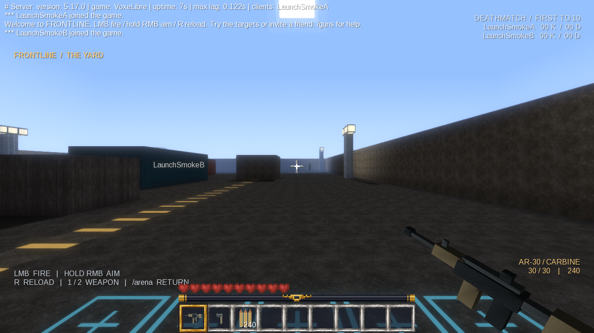

# Frontline — Minecraft 風格雙人槍戰

以 **Luanti 5.17.0 + VoxeLibre 0.92.3** 建立的 Windows 64 位元可遊玩原型。加入一張工業貨場、兩把 3D 槍械、256px 寫實表面、練習靶與多人死亡競賽。



## 直接開始

這個工作目錄已安裝引擎與遊戲。直接雙擊 **`Start-Game.cmd`**：會啟動本機伺服器，並以 `Player1` 進場。首次載入 VoxeLibre 的素材可能需要約一分鐘。

- `Start-SecondPlayer.cmd`：在同一台電腦開啟 `Player2`，可自行檢查雙人連線。
- `Stop-Server.cmd`：儲存並停止背景伺服器。關閉遊戲視窗不會停止伺服器。
- `Start-Server.cmd`：獨立開啟伺服器，供另一台電腦連入。
- `Join-Game.cmd`：輸入主機 IP，進入連線選單。**第一次先更改玩家名稱並註冊；之後使用相同名稱與密碼登入。**
- `Setup.cmd`：從原始碼專案重建缺少的執行環境；只有尚未下載引擎時需要 Python 3.10+ 和網路。

打包好的便攜 ZIP 已含引擎、遊戲和素材；解壓後執行遊戲不需 Python、Java、C++ 編譯器或 Minecraft 帳號。

## 兩台電腦一起玩

1. 主機電腦執行 `Start-Game.cmd`。主機玩家使用自動建立的本機 `Player1` 帳號。
2. 將便攜 ZIP 給朋友，在另一台 Windows 電腦解壓。
3. 主機用 `ipconfig` 查看目前網路介面的 IPv4 位址，例如 `192.168.1.10`。
4. 朋友執行 `Join-Game.cmd`，輸入主機 IPv4，將選單中的名稱改為自己的名稱並註冊登入。
5. 如果 Windows 防火牆詢問，允許 Luanti 通過私人網路。伺服器使用 **UDP 30000**。

不同住家的網路需額外讓主機 UDP 30000 可達，例如路由器轉送或雙方使用同一個虛擬區域網路；若家用網路處於 CGNAT，單純轉送可能無法使用。此專案不依賴公共配對服務。

預設最多 8 名玩家，已驗證同機兩個獨立網路客戶端連線；尚未使用兩台不同實體電腦或跨網際網路實測。

## 操作與規則

| 操作 | 功能 |
|---|---|
| WASD、滑鼠、空白鍵 | 移動、轉向、跳躍 |
| 左鍵 | 步槍按住連射；手槍每按一次射擊一次 |
| 按住右鍵 | 縮放瞄準，降低散布 |
| R | 換彈；配套客戶端將 Luanti 的 Aux1 輔助鍵設為 R |
| Shift + 右鍵，或 `/reload` | 使用其他 Luanti 客戶端時也可換彈 |
| 1 / 2 | 一般初始背包配置下切換步槍／手槍 |
| G | 丟棄手持物；配套客戶端將原本的 Q 改為 G |
| I | 背包 |
| `/arena` | 脫離戰鬥 10 秒後，回到出生點並補給 |
| `/kit` | 出生點附近且脫離戰鬥時補給 |
| `/score`、`/guns` | 查看計分／操作說明 |

步槍 30 發、手槍 12 發，兩者共用備用彈藥。換彈需要時間且會消耗備彈；切換或更換武器、死亡或離線會取消換彈。出生後有 3 秒子彈保護，主動射擊會立即解除自己的保護。

子彈採伺服器射線判定，會被實心牆面阻擋，並支援頭部加成。傷害沿用 VoxeLibre 的投射物傷害流程及護甲機制。死亡後 2 秒自動重生並取得新裝備。先達 10 殺獲勝，7 秒後自動開新局。

地圖兩側有可射擊、擊毀後重建的練習靶。一人也能練習。競技場受保護，避免對戰中被拆掉；整個 VoxeLibre 世界仍保留在競技場外，使用其他世界安裝此模組時可設定 `frontline_arena = false`。

## 畫質

預設平衡畫質：256px 表面、2048 陰影、泛光、FXAA。啟動器另有設定：

```powershell
powershell -NoProfile -ExecutionPolicy Bypass -File scripts\launch.ps1 -Mode Play -Quality high
powershell -NoProfile -ExecutionPolicy Bypass -File scripts\launch.ps1 -Mode Play -Quality performance
```

`high` 開啟體積光和 4096 陰影；`performance` 關閉動態陰影。這台開發電腦的 GTX 1660 Ti 已成功渲染遊戲，但沒有為任何畫質預設保證固定 FPS。

貨場使用改製的 CC0 攝影材質；石頭、泥土、草地表面與木板有可選的對應材質包。**這是部分材質覆蓋，並非整個 VoxeLibre 全部素材都已寫實化，也沒有 RTX／路徑追蹤。** 槍械目前是原創簡化 3D 模型，包含鏡頭後座力與縮放瞄準；尚未提供完整雙手骨骼換彈動畫或準星貼合的瞄具動畫。

## 修改與測試

| 路徑 | 內容 |
|---|---|
| `mods/frontline/rules.lua` | 彈匣、射速、換彈時間、傷害與散布 |
| `mods/frontline/weapons.lua` | 伺服器射擊、彈藥、換彈、瞄準與 HUD |
| `mods/frontline/arena.lua` | 地圖、練習靶、出生、計分與回合 |
| `config/server.conf` | 人數、連線埠與遊戲規則 |
| `config/client.conf` | 新玩家的畫質與按鍵範本 |
| `scripts/generate_assets.py` | 重建原創模型、UI、音效與改製材質 |
| `dependencies.lock.json` | 上游版本、來源與 SHA-256 |
| `worlds/frontline` | 正式遊戲存檔與帳號資料 |
| `logs` | 伺服器及各玩家的記錄 |

修改模組後先停止伺服器，再重新執行啟動器；它會同步 `mods/frontline` 到世界內，不會刪除世界存檔。既有場景的幾何不會自動重建，修改地圖產生碼後應使用新的測試世界驗證。

```powershell
python scripts\test_integration.py
```

測試會建立獨立世界，以兩個真實 Luanti 客戶端連到 localhost，檢查阻擋、射速、遠距傷害、爆頭、PvP 開關、出生保護、彈藥、換彈取消、計分與重生；輸出位於 `tests/artifacts`。不使用或清空正式遊戲世界。

重新產生素材需要 `pip install Pillow` 和可用的 FFmpeg；直接遊玩使用已附帶素材，不需安裝這些工具。

管理員可在關閉伺服器後於 `config/server.conf` 設定 `name = 自己的玩家名稱`，取得 Luanti 的服主管理權；`/roundreset` 需要 `server` 權限。

## 授權與來源

本專案原創程式、模型、UI 與合成音效採 GPL-3.0-or-later。攝影材質來源採 CC0，詳見 `assets/sources.json` 與 `THIRD_PARTY.md`。VoxeLibre 的原始碼及素材沿用其原授權；Luanti 採 LGPL-2.1-or-later。所有第三方檔案保留原始授權。

此專案是獨立開源遊戲模組，不是 Minecraft Java／Bedrock 的模組，不能直接載入 TaCZ、Forge 或 Iris 模組。
